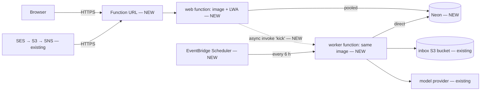

# Scale-to-zero deployment — AWS Lambda + Neon

Extends: .ai/specs/2026-09-05-walking-skeleton.md
Extends: .ai/specs/2026-09-26-reservation-inbox.md

## 📝 TLDR

The app is used now and then, but the server hosting it runs (and costs money) all the time. Today it runs on an always-on Hetzner host: Caddy, the app and Postgres under `deploy/compose.prod.yml`. **Proposed:** add a second deployment target where the same image runs on AWS Lambda through the Lambda Web Adapter, and the database is Neon serverless Postgres. When nobody uses the app, both scale to zero. The compose deployment stays supported. Two parts of the current app do not survive Lambda unchanged: the inbox's background thread and attachments larger than Lambda's payload limit. This spec moves the worker into a second function from the same image, and lowers the per-file upload limit from 10 MB to **4 MB**, on the owner's decision of 2026-11-27.

## 📝 Problem Statement

- The owner said the app "won't be running all the time" and asked for something that scales to zero, like Cloud Run (issue #24). Usage is one owner planning occasional trips (product brief P1/P2, single respondent `[ASSUMPTION]` A01). An always-on host pays for idle hours that this usage pattern does not need.
- **The saving is not quantified.** The current host is a Hetzner CPX22 (`deploy/README.md`), which is cheap. The case for this work is cost and operational posture (no host to patch, no Postgres to back up by hand — PR #13 states "nothing schedules a backup yet"), not a measured cost problem. This is recorded so the owner can weigh it; it is not a blocker.
- Secondary gains: Neon provides point-in-time restore, which today's `pg_dump`-by-hand does not. The inbox's S3 access can use the Lambda execution role instead of long-lived AWS access keys on the host.

## 📝 Prior spec drift

- `.ai/specs/2026-09-05-walking-skeleton.md` A12 says "managed Postgres". The shipped deployment runs Postgres as a compose service on the same host (`deploy/compose.prod.yml`, `db` service). This spec moves the Lambda target to a managed Postgres (Neon). The compose target is not changed.
- A12 lists "four required environment variables". `backend/trip_planner/config.py` now also reads the optional inbox block (`INBOX_*`, set together or not at all) and the model block. This spec carries all of them over unchanged.

## 📝 Proposed Solution

One image, two deployment targets:

| | Compose (today, unchanged) | Lambda (new) |
|---|---|---|
| Compute | `uvicorn` in a long-lived container | Same image; the Lambda Web Adapter (LWA) extension turns invocations into HTTP to `uvicorn` on `localhost:8000` |
| Ingress / TLS | Caddy + Let's Encrypt | Lambda Function URL (HTTPS on an AWS hostname) |
| Database | Postgres container | Neon: **pooled** endpoint for the web function, **direct** endpoint for the worker and migrations |
| Inbox worker | Thread in the app lifespan, every 30 s | A separate **worker function** from the same image, *kicked* after each SNS receipt and run on a low-frequency schedule for retries and cleanup |
| Release step | `migrate` compose service | `migrate` run from the deploy script against Neon's direct endpoint, before the new version is published |
| Infrastructure | Files in `deploy/` | AWS SAM template in `deploy/lambda/`, plus a documented manual Neon setup |

### Why the inbox worker changes shape

Lambda freezes an execution environment between requests and removes it when idle. A thread started in the lifespan (`backend/trip_planner/app.py`, `_inbox_lifespan`) would therefore run only during requests, and never while the app is idle, which is exactly when mail arrives. Polling with a schedule would fix that but **defeat scale-to-zero**: a drain every minute touches Neon every minute, and Neon suspends compute only after several idle minutes. So:

- **The kick.** After `POST /api/v1/inbox/receipts/sns` commits the receipt row, the web function invokes the worker function **asynchronously**, so the request does not wait for it. A new message is picked up within seconds, which is better than today's 30 s, and Neon stays awake only while there is work. A kick that fails is logged and is not an error for SNS: the row is already durable, and the schedule catches up.
- **The schedule.** EventBridge Scheduler invokes the worker every `INBOX_WORKER_SCHEDULE` (default **6 hours**) for model-outage retries, `deferred` messages and the S3 cleanup pass. This is the only standing cost of an idle deployment: about 4 Neon wake-ups a day.
- The worker function runs `InboxWorker.run_once()` (`backend/trip_planner/scheduler.py`). That is the same unit the tests already drive, so no ingestion logic changes. It runs with **reserved concurrency 1**, and the existing `pg_try_advisory_lock` stays as the backstop.

### Alternatives considered, and why they lost

- **AWS App Runner / ECS Fargate.** Neither truly scales to zero: App Runner bills memory for idle provisioned instances, and Fargate services have no native zero. ECS also needs a load balancer that costs money while idle.
- **Cloud Run + Neon.** This needs no worker redesign beyond the kick (Cloud Run can also throttle CPU after responses) and has no 6 MB payload limit. It lost only because the inbox is already built on AWS SES/SNS/S3 (`.ai/specs/2026-09-26-reservation-inbox.md`). Keeping compute in the same cloud avoids cross-cloud credentials for the S3 fetch. **It remains the pivot if the 4 MB upload limit proves too tight.**
- **Aurora Serverless v2 with 0 minimum capacity.** It stays inside AWS, but resume time (seconds to tens of seconds, verify) lands on the first request after idle, and it adds VPC networking. Lambda would then need a VPC, and the SNS certificate fetch, the model provider calls and S3 would need a NAT gateway or endpoints. A NAT gateway is a standing hourly cost, which defeats the purpose. Neon is on the public internet, so the functions stay outside a VPC.
- **Run the drain inline in the SNS request.** The model call has a 30 s timeout with retries (`backend/trip_planner/integrations/model.py`, `TIMEOUT_SECONDS`). Holding SNS's HTTPS delivery that long risks SNS timing out and redelivering. The durable-row-then-acknowledge contract from the inbox spec would also blur.
- **API Gateway instead of a Function URL.** HTTP APIs cap integrations at about 30 s (verify) and add a per-request cost. A Function URL has neither, and supports response streaming.
- **Poll with the schedule every minute.** Rejected above: it keeps Neon awake around the clock.

## 📝 Delta

### Capability: inbox-ingestion

#### ADDED Requirement: Ingestion is triggered by receipt on the Lambda target
The system SHALL, on the Lambda target, start an ingestion pass after it durably records a verified SNS receipt, without delaying the SNS acknowledgement.

##### Scenario: A forwarded confirmation arrives while the app is idle
- WHEN SNS delivers a verified receipt to the web function
- THEN the receipt is committed, `200` is returned, and the worker function is invoked asynchronously
- AND the message reaches `ingested` (or its next state) without waiting for a schedule

##### Scenario: The kick fails
- WHEN the asynchronous invoke of the worker function raises
- THEN the SNS request still answers `200` (the row is durable), the failure is logged, and the next scheduled pass processes the message

#### ADDED Requirement: Scheduled passes on the Lambda target
The system SHALL run an ingestion and cleanup pass on a schedule of `INBOX_WORKER_SCHEDULE` (default 6 hours) on the Lambda target, so retries, `deferred` messages and S3 cleanup proceed with no traffic.

##### Scenario: A model outage cleared overnight
- WHEN a message stays `received` because the model failed, and no new mail arrives
- THEN the next scheduled pass retries it

The compose target keeps today's 30 s in-process loop unchanged; `backend/tests/test_scheduler.py` keeps pinning it.

### Capability: http-delivery

#### MODIFIED Requirement: Security headers on every response
The system SHALL set `X-Content-Type-Options: nosniff`, `X-Frame-Options: DENY` and `Referrer-Policy: strict-origin-when-cross-origin` on every response, plus `Strict-Transport-Security` when `ENVIRONMENT=production`, from the application itself rather than from the reverse proxy, without weakening a stricter header a route sets.

##### Scenario: The Lambda target, with no proxy in front
- WHEN a browser requests `/login` through the Function URL
- THEN the response carries all four headers

##### Scenario: A route with its own stricter policy
- WHEN an attachment's content is served
- THEN its sandbox CSP and its own headers are unchanged

Frozen by: `backend/tests/test_security.py` (characterization added in Phase 1 step 10)

#### MODIFIED Requirement: Hashed assets are cached as immutable
The system SHALL serve files under `/assets` with `Cache-Control: public, max-age=31536000, immutable`, and SHALL keep serving `index.html` with `Cache-Control: no-store`.

##### Scenario: A returning visit
- WHEN the owner opens the app a second time after the same build
- THEN the browser loads the bundles from its cache and requests only `index.html` and API calls

##### Scenario: A new build
- WHEN a new image is deployed
- THEN the next page load fetches the new `index.html`, which names the new hashed bundles

Frozen by: `backend/tests/test_spa.py` (characterization added in Phase 1 step 10)

### Capability: attachments

#### MODIFIED Requirement: Per-file upload limit
The system SHALL refuse an uploaded attachment larger than **4 MiB** with `attachment_too_large`, and SHALL keep serving stored attachments up to 10 MiB.

##### Scenario: A file just over the limit
- WHEN the owner uploads a PDF of 4 MiB + 1 byte
- THEN the upload is refused with `attachment_too_large` and nothing is stored
- AND the frontend tells the user before sending, in the user's language, that the limit is 4 MB

##### Scenario: A file at the limit
- WHEN the owner uploads a PDF of exactly 4 MiB
- THEN it is stored

##### Scenario: An attachment stored before the change
- WHEN the owner opens a 9 MB attachment uploaded under the old limit
- THEN it downloads in full, on both targets

Frozen by: `backend/tests/test_attachments_api.py` (`test_a_file_one_byte_over_the_cap_is_refused`, `test_a_file_of_exactly_the_cap_is_stored`)

## 📝 Architecture

The inbox's ingestion path stays as it is. What is new is how the worker gets invoked, and the compute and database it runs on.

### The image (`deploy/Dockerfile`)

- Add the LWA binary at `/opt/extensions/lambda-adapter`, pinned to a version, not `latest`. Outside Lambda the extension directory is inert, so `compose.yml` and `compose.prod.yml` run the identical image. The compose-shape tests in `backend/tests/test_startup.py` keep pinning that target.
- Set `AWS_LWA_PORT=8000` and `AWS_LWA_READINESS_CHECK_PATH=/api/v1/health`.
- **Worker mode.** The worker function uses the same image with `command: ["worker"]`, a new `entrypoint.sh` case. It starts `uvicorn` on a **separate ASGI app** (`trip_planner.worker_app:create_worker_app`). That app exposes only `POST /events`, the LWA pass-through path for non-HTTP events (verify the default path and the `AWS_LWA_PASS_THROUGH_PATH` name), plus health. It never mounts the public API. The web function never mounts `/events`. So a request to `/events` through the public Function URL gets a 404 from the router, not a drain.

### The SPA and the headers Caddy adds today

The frontend is built into the image (`deploy/Dockerfile`, first stage) and served by FastAPI from one origin (`backend/trip_planner/spa.py`): hashed bundles under `/assets` through `StaticFiles`, and `index.html` with `Cache-Control: no-store` for every non-API path. On Lambda this does not change: every request, including asset requests, goes through the web function. That raises two problems, and both are fixed in the app so they hold on both targets:

- **Security headers move from Caddy into the app.** Today `deploy/Caddyfile` adds `Strict-Transport-Security`, `X-Content-Type-Options: nosniff`, `X-Frame-Options: DENY` and `Referrer-Policy: strict-origin-when-cross-origin`, and strips `Server`. A Function URL adds none of them, so the Lambda target would silently lose clickjacking and MIME-sniffing protection. A middleware in `create_app` sets the same four headers on every response. HSTS is set only when `ENVIRONMENT=production`, because the app refuses to start in production without `https://`. The middleware never overrides a stricter header a route already sets, such as the attachment content routes' own `nosniff` and sandbox CSP. `serve` runs uvicorn with `--no-server-header`. On compose, Caddy's `header` directive replaces rather than appends, so the headers are not duplicated, and the Caddyfile stays as it is.
- **Hashed assets are cached as immutable.** `StaticFiles` sends only `ETag` / `Last-Modified`, so a browser revalidates every bundle on every visit. Each 304 is a Lambda invocation, and each one waits through a cold start. Files under `/assets` carry a content hash in their name, so they get `Cache-Control: public, max-age=31536000, immutable`; `index.html` keeps `no-store`, which is what makes a new build reach the browser. After the first visit, only `index.html` and API calls invoke the function.

Serving the SPA from S3 + CloudFront was considered and deferred. It only pays off together with a custom domain (A4): CloudFront would then route `/api/*` to the Function URL and everything else to S3, keeping one origin. With immutable caching, the browser makes almost no asset requests anyway.

### The web function

- `create_production_app` on Lambda: the inbox lifespan thread is **not** started. A new setting `INBOX_WORKER_MODE` takes `thread` (default; today's behaviour) or `lambda`. In `lambda` mode `start_inbox_worker` is skipped, and the receipt endpoint calls a `WorkerKick` port **after an explicit commit**. Today the handler only `flush()`es (`api/inbox.py`, end of the receipt recording) and the commit happens later, in `get_db` teardown (`api/deps.py`). A kick fired from the handler as it stands could start the worker before the row is visible, and the message would then wait for the schedule. So in `lambda` mode the handler commits, then kicks. `BackgroundTasks` is not an option: Lambda freezes the environment once the response is sent.
- `WorkerKick` lives in `backend/trip_planner/inbound/` next to `S3Fetcher` and follows its pattern: lazy `boto3` client, connect and read timeout, never on import. It runs `lambda.invoke(FunctionName=INBOX_WORKER_FUNCTION, InvocationType="Event")`. In `thread` mode it is a no-op.
- Database: a pooled Neon URL, with **`NullPool`** for the web engine (`backend/trip_planner/db/session.py`) when `DB_POOL=null` is set. Each request opens a client connection to Neon's pooler and closes it at the end. A client-side pool would keep connections open inside frozen environments: they would count against the pooler's client limit and might keep Neon from suspending (verify). Connecting per request to a pooler costs one TLS handshake, which is small next to a cold start.
- **Prepared statements through the pooler.** psycopg 3 prepares server-side after repeated execution. Neon's PgBouncer must support that in transaction mode (verify). If it does not, set `prepare_threshold=None` through `connect_args` for the pooled URL. A test on the pooled endpoint decides it in Phase 1.
- Reserved concurrency: **10** (configurable). It caps both cost under a request flood and the number of Neon connections.

### The worker function

- Database: the **direct** (unpooled) Neon URL. This is required, not a preference. `run_once` takes a *session-level* `pg_try_advisory_lock` on a dedicated session and releases it later (`scheduler.py`, `_take_lock` / `_release_lock`). Behind a transaction-mode pooler the unlock can land on a different server connection, so the lock leaks and the inbox stops for good. The scheduler's docstring already names this failure as "a permanent, silent outage". The transaction-scoped locks in `security/quota.py` and `api/attachments.py` (`pg_advisory_xact_lock`) are pooler-safe, so the web function can use the pooled URL.
- Reserved concurrency **1**; timeout **5 minutes**; no retries on async invoke failure (the schedule is the retry). The worker gets no Function URL.
- **A time budget, not one batch.** The handler calls `run_once()` in a loop until it returns 0 or a **4-minute budget** is spent, so one kick drains a backlog larger than `BATCH_SIZE` (10). The budget is checked between messages, so a pass with a 30 s model timeout and retries cannot run into the Lambda timeout. If Lambda kills a run anyway, the session-level advisory lock is held until Postgres notices the dead connection. The worker's direct URL therefore sets TCP keepalives (`keepalives_idle` and related options) so that happens in about a minute, not hours.

### Migrations

`deploy/lambda/deploy.sh` runs, in order: build and push the image → `migrate` locally, in the built image, against `DATABASE_URL_DIRECT` → `sam deploy`. This keeps the spec's "migrate before the new image takes traffic". DDL through a transaction-mode pooler is unsafe, which is why migrations use the direct URL.

### Configuration (`BACKWARD_COMPATIBILITY.md` §5)

All additions are **optional with defaults that reproduce today's behaviour**:

| Variable | Default | Lambda value |
|---|---|---|
| `INBOX_WORKER_MODE` | `thread` | `lambda` |
| `INBOX_WORKER_FUNCTION` | unset | the worker function's name (required when mode is `lambda` and the inbox is configured; startup names it if missing) |
| `INBOX_WORKER_SCHEDULE` | n/a (SAM parameter) | `rate(6 hours)` |
| `DB_POOL` | unset (SQLAlchemy `QueuePool`) | `null` on the web function |

`DATABASE_URL`, `SESSION_SECRET`, `APP_BASE_URL`, `ENVIRONMENT` and the `INBOX_*` / model blocks keep their names and meaning. Secrets (`SESSION_SECRET`, database URLs, the model API key) live in SSM Parameter Store SecureString and are resolved by SAM at deploy time. They are never written into the template.

### Client IP (login rate limit)

`client_ip` (`backend/trip_planner/security/rate_limit.py`) trusts the **first** `X-Forwarded-For` element. Behind Caddy that is safe, because Caddy replaces the header. Behind a Function URL, a client-supplied `X-Forwarded-For` may be preserved with AWS's address appended (verify). Then the first element is attacker-chosen, and the per-IP login limit (R08 posture) could be bypassed by rotating a fake header. Phase 1 adds a test-pinned rule. On the Lambda target, take the client address from the hop AWS appends (the **last** element), selected by a `TRUSTED_PROXY_HOPS`-style setting whose default keeps today's behaviour. The setting name is fixed at implementation.

The fallback path is affected too. `entrypoint.sh` runs uvicorn with `--proxy-headers --forwarded-allow-ips '*'`, which rewrites `request.client` from the same header. So the `request.client` fallback in `client_ip` is attacker-controlled as well. On the Lambda target, `serve` runs without `--forwarded-allow-ips '*'` (LWA connects from `127.0.0.1`). The test pins both paths. The `client_ip` docstring's "at worst rate-limit himself" no longer holds once the header can be rotated, so it is corrected in the same change.

### Hostname

Phase 1 uses the Function URL hostname (`https://<id>.lambda-url.<region>.on.aws`) as `APP_BASE_URL`, which `ENVIRONMENT=production` accepts. A custom domain needs CloudFront in front of the Function URL. That is deferred until a domain is registered; it is the same trigger `deploy/README.md` already names for leaving sslip.io.

### Region

Lambda, the worker and Neon all go in `INBOX_AWS_REGION`, the region the SES receipt rule and the bucket already live in, so the S3 fetch stays in-region. Neon's project region is chosen to match.

## 📝 Data Model

No schema change. The data moves once from the compose Postgres to Neon (Phase 3). `attachment_blob` stays `BYTEA` in Postgres. Neon's storage tier must hold `MAX_INSTALLATION_BYTES` (2 GiB, `security/quota.py`), which is likely above the free tier (verify). The current database size is measured in Phase 0.

## 📝 API Contracts

No route, request or response shape changes on the web app. `POST /api/v1/inbox/receipts/sns` keeps its contract; it only gains a post-commit side effect.

The worker app's `POST /events` is not a public contract. It is reachable only through the LWA pass-through on a function that has no Function URL.

**Attachments — the one contract change (§1 HTTP API, owner decision A1).** Through a buffered Function URL the request payload cap is ~6 MB and binary bodies travel base64-encoded (×4/3), so the effective upload ceiling is about **4.5 MB** (verify both figures). Therefore:

- **Upload:** the per-file limit drops from 10 MiB to **4 MiB** on both targets. The error code (`attachment_too_large`), its status and the response shape stay the same; only the threshold moves. The frontend pre-check (`MAX_UPLOAD_BYTES` in `frontend/src/features/trips/UploadDropzone.tsx`) and the copy in `en.json` / `pl.json` (`hint`, `attachment_too_large`) say 4 MB. Translation keys do not change, so §4 is untouched.
- **Stored bound stays 10 MiB.** Attachments uploaded before this change can be up to 10 MiB, and the database `CHECK` (`byte_size <= 10485760`, migration `0005_attachment.py`) must keep accepting them. So `MAX_ATTACHMENT_BYTES` is split: a new **upload limit** (4 MiB) gates `POST`, and the existing constant becomes the **stored bound** (10 MiB) used by the model's `CHECK` and by inbound documents (`domain/inbound.py`). Inbound documents arrive through the worker, not through a request, so they keep 10 MiB. No migration.
- **Download:** files up to 10 MiB must stay readable, which exceeds a buffered response. The web function's Function URL uses **response streaming** (`InvokeMode: RESPONSE_STREAM`, LWA `AWS_LWA_INVOKE_MODE=response_stream`); the streamed-response limit is above 10 MiB (verify). Nothing changes on the compose target.

## 📝 Edge Cases & Failure Scenarios

| Scenario | What happens | What the user sees |
|---|---|---|
| First request after idle | Lambda cold start (image pull, Python, uvicorn, LWA readiness), plus Neon resume on the first query | One slow page load, roughly 1–5 s total (measured in Phase 2; budget stated on the PR) |
| Login during a cold start | `response_floor` still pads to its fixed time; the cold start adds to it | Slower login, same answer shape |
| Neon unreachable | `pool_pre_ping` / connect fails → existing 503 `service_unavailable` handling (`app.py`) | The existing unavailable state |
| Worker kick fails | Logged; SNS gets `200`; the schedule picks it up | Mail appears in `/inbox` up to 6 h later instead of seconds |
| Two kicks at once | Reserved concurrency 1 throttles the second; async invoke retries it later, and the advisory lock is the backstop | Nothing |
| Worker times out mid-batch | The 4-minute budget stops between messages, so the 5-minute timeout should not fire. If it does, committed rows stay, and TCP keepalives free the advisory lock within about a minute | Nothing |
| Upload between 4 MiB and the platform cap | The app refuses it with `attachment_too_large`; the frontend pre-check stops it first | The existing "file too large" message, now saying 4 MB |
| Upload above ~4.5 MB that bypasses the frontend | Function URL rejects the payload before the app sees it | A generic error instead of `attachment_too_large`. Only a hand-crafted request can get here |
| Downloading a 10 MB attachment stored before the change | Streamed response | The file, as today |
| Request flood | Reserved concurrency 10 → throttled `429`s from AWS | Errors under abuse instead of an unbounded bill |
| A lambda environment frozen mid-connection | Neon closes the idle server connection; `pool_pre_ping` replaces it | Nothing |
| Rollback | Compose host kept for 14 days after cutover, `app` stopped and `db` intact; DNS is not involved because the hostnames differ | A switch back via the previous URL. Writes made on Lambda after cutover would need a reverse dump; stated in the runbook |

## 📝 Security

- **The Function URL is public with `AuthType: NONE`.** That is equivalent to today's open 443: the app's own session, CSRF and rate limiting are the controls (R08). No new unauthenticated route: `/events` exists only in the worker app.
- **IAM.** The web function may `lambda:InvokeFunction` on the worker only. The worker gets `s3:GetObject` / `s3:DeleteObject` on the inbox bucket prefix only. Neither gets wildcard resources.
- **Secrets** in SSM SecureString, resolved at deploy time; nothing in the template or the repo.
- **Client IP** rule above, test-pinned, before the Lambda target takes real logins.
- **Response headers** (HSTS, `nosniff`, `X-Frame-Options`, `Referrer-Policy`) move from Caddy into the app, test-pinned, so the Lambda target does not lose them (see "The SPA and the headers Caddy adds today").
- **Neon network.** Neon is reachable from the internet, with access controlled by credentials and TLS (`sslmode=require`). If Neon's IP allow-list is available on the chosen plan, it cannot be used with Lambda (no stable egress IP without a NAT). This is accepted and stated, not hidden.

## 📝 Risks & Impact Review

- **Attachments contract (§1 HTTP API).** Lowering the upload limit is user-visible: a 5–10 MB PDF that uploads today will be refused. It is easy to reverse (one constant and two strings). Stored data is untouched because the stored bound stays 10 MiB. The owner accepted this on 2026-11-27.
- **Two deployment targets to keep working.** The compose target stays tested (the compose-shape tests in `backend/tests/test_startup.py`). The Lambda target gets a template-validation test (`sam validate`) and a smoke probe in the runbook. Dropping compose later is a separate decision.
- **Vendor coupling.** LWA is open source and a single file in the image; removing it reverts the image. Neon is plain Postgres; `pg_dump` moves the data out.
- **Cost shape.** Idle cost is close to zero, plus Neon storage, the S3 bucket and the 6-hourly wake-ups. A traffic spike costs per request, capped by reserved concurrency.
- **Unverified platform facts.** The payload limits, LWA paths and variables, the pooler's prepared-statement support and Neon tier limits were written from memory, without web verification. Phase 0 verifies them, and any that differ are corrected in the implementation PR's notes.

## 📝 Decisions in play

- **D14 / R08** (public from day one, nothing reachable without a session or magic link): unchanged. The Function URL is public just as Caddy's 443 is, and no route is added to the web app.
- **A12** of the walking-skeleton spec (one image, managed Postgres, migrations before traffic, TLS at the proxy): honoured. Still one image; the worker function is a second *configuration* of it, not a second deployable artifact.
- **Reservation-inbox spec, "no separate worker process or queue"**: honoured in substance. There is no new queue, and the worker is the same code on the same image. It rejected a second container because A12 fixed one image, and that still holds. The owner confirmed this reading on 2026-11-27 (A2).
- **D16** (attachments in PostgreSQL; PDF/JPEG/PNG; **10 MB per file**): **superseded in part.** The per-file upload limit becomes 4 MB; storage and formats are unchanged. The owner approved this on 2026-11-27. The implementation PR adds the superseding decision row to `.ai/specs/product-brief.md` and updates the two brief lines that say "up to 10 MB".
- **D24** (one explicitly configured model provider): unchanged; the worker reads the same variables.

## Resolved assumptions (autonomous defaults)

| # | Question | Default applied | Why |
|---|---|---|---|
| A1 | Lambda caps buffered payloads at ~6 MB (≈4.5 MB of binary upload), while attachments allow 10 MiB. Lower the limit, or move attachment bytes to S3 via presigned URLs? | **Lower the per-file upload limit to 4 MiB, in this spec, on both targets.** Stored attachments and inbound documents keep their 10 MiB bound, and downloads stream so files already stored stay readable. **Confirmed by the owner on 2026-11-27 (PR #25); supersedes the limit half of D16.** | The owner chose the quick option over moving bytes to S3. 4 MiB leaves room under the ~4.5 MB base64 ceiling for the multipart envelope and the event's headers. Reversible: raising it later is the same constant, once the bytes leave the request path |
| A2 | How does the inbox worker run without a long-lived process? | **A worker function from the same image, kicked asynchronously after each receipt and scheduled every 6 h**; the compose target keeps the thread. **Confirmed by the owner on 2026-11-27 (PR #25).** | Reading the inbox spec as "no second process" would make Lambda impossible. A minute-level schedule would keep Neon awake 24/7. Inline processing risks SNS redelivery |
| A3 | Infrastructure-as-code tool? | **AWS SAM** (`deploy/lambda/template.yaml`); Neon set up by hand and documented | Native Function URL, schedule and IAM in one YAML file. No state backend to host (Terraform) and no app to maintain (CDK). Reversible: the template is small |
| A4 | Hostname? | **The Function URL hostname**; custom domain + CloudFront deferred until a domain exists | Same trigger the README already uses for leaving sslip.io; no new paid component |
| A5 | What happens to the Hetzner deployment? | **Kept supported in the repo; the host is kept, app stopped, for 14 days after cutover, then decommissioned by the owner** | Rollback path; the compose target is also the local stand-up |
| A6 | Which region? | **`INBOX_AWS_REGION`** for Lambda and the worker; Neon in the matching region | Keeps S3 reads in-region; one region to reason about |
| A7 | Reserved concurrency? | **Web 10, worker 1** | Caps cost and Neon connections; the worker count matches the advisory-lock design |
| A8 | Is the saving worth it? | **Proceed; the cost is measured in Phase 4 against the Hetzner invoice** | The owner asked for it; the issue records that it is unquantified |

## 📋 Phasing

- **Phase 0 — Verify and measure.** No code. Confirms the platform facts this spec takes from memory and measures the database.
- **Phase 1 — Lambda-ready image and app.** Mergeable on its own; the compose deployment behaves exactly as today.
- **Phase 2 — Stand up the Lambda target** beside compose, against an empty Neon database, with smoke probes. No real users.
- **Phase 3 — Cutover.** Needs Phases 1–2 merged and probed, including the 4 MB limit and streamed downloads. Moves the data, switches `APP_BASE_URL` and the SNS subscription, and keeps the rollback window.
- **Phase 4 — Decommission and measure.** Hetzner off after the window; one month's cost compared.

## 📋 Implementation Plan

### Phase 0 — Verify and measure

1. Verify against current AWS, LWA and Neon documentation and record the findings in the implementation PR: Function URL buffered request and response limits and base64 handling; response-streaming limit; LWA version, `AWS_LWA_PORT` / `AWS_LWA_READINESS_CHECK_PATH` / the pass-through path and its variable; how Function URLs set `X-Forwarded-For`; Neon pooler support for psycopg 3 prepared statements; Neon autosuspend delay and storage tier for 2 GiB. Correct this spec's assumptions in the PR body where they differ.
2. Confirm the inbox SNS subscription has its dead-letter queue configured (Phase 3 relies on it).
3. Measure the production database size (`pg_database_size`) and the `attachment_blob` share on the Hetzner host.

### Phase 1 — Lambda-ready image and app (compose unchanged)

1. **Characterize** the current receipt path: a test asserting that `POST /inbox/receipts/sns` commits the row and makes no outbound call beyond today's (extends `backend/tests/test_inbox_receipts.py`). Commit alone, green.
2. Add `INBOX_WORKER_MODE`, `INBOX_WORKER_FUNCTION` and `DB_POOL` to `config.py`, optional with today's defaults. Startup names `INBOX_WORKER_FUNCTION` when mode is `lambda` with the inbox configured. Tests in `backend/tests/test_config.py`.
3. `WorkerKick` port in `backend/trip_planner/inbound/` (no-op in `thread` mode, lazy `boto3` `lambda.invoke` with timeouts in `lambda` mode). Wire it into the receipt endpoint: in `lambda` mode, commit explicitly, then kick. A test asserts the row is visible from a separate session when the kick fires. A kick failure logs and still answers `200`. Tests use a fake client, like the existing `S3Fetcher` tests.
4. `_inbox_lifespan` skips the thread in `lambda` mode. Test: no thread started.
5. `trip_planner/worker_app.py`: an ASGI app with only `POST /events` → `run_once()` looped under the 4-minute budget, and health. Tests: a backlog of 25 drains in one event; the budget stops between messages. A test asserts the web app's route table has no `/events` and the worker app's has nothing else (extends the route-enumeration test in `backend/tests/test_route_protection.py`).
6. `DB_POOL=null` → `NullPool` in `db/session.py`. If Phase 0 found the pooler unsafe for prepared statements, set `prepare_threshold=None` for the web engine. Test on the engine's configuration.
7. Client-IP hop rule in `security/rate_limit.py`, behind a setting whose default keeps today's first-element behaviour; `entrypoint.sh` `serve` drops `--forwarded-allow-ips '*'` when that setting selects the Lambda rule. Tests for a spoofed header with each setting, covering both the header path and the `request.client` fallback (extends `backend/tests/test_rate_limit.py`).
8. **Characterize** the upload limit: `test_a_file_one_byte_over_the_cap_is_refused` and `test_a_file_of_exactly_the_cap_is_stored` in `backend/tests/test_attachments_api.py` already pin 10 MiB; confirm they are green, plus a test that a stored 10 MiB row stays readable. Commit alone.
9. **Change** the limit: add the 4 MiB upload limit in `domain/uploads.py`, keep the 10 MiB stored bound for the model `CHECK` and `domain/inbound.py`, and gate `api/attachments.py` (`MAX_BODY_BYTES` and the post-parse check) on the upload limit. Update the two characterization tests to 4 MiB, and keep the stored-row test at 10 MiB. Frontend: `MAX_UPLOAD_BYTES`, `uploadDropzone.test.tsx`, `api/attachments.test.ts`, and the `hint` / `attachment_too_large` strings in `en.json` and `pl.json`. Add the D16-superseding row to `.ai/specs/product-brief.md`.
10. **Characterize** the response headers on the compose target: a test in `backend/tests/test_security.py` records that the app itself sets none of the four Caddy headers today, and a test in `backend/tests/test_spa.py` records `/assets` without a long-lived `Cache-Control`. Commit alone.
11. **Change:** add the security-headers middleware (HSTS only in production, never overriding a route's own stricter header) and immutable caching for `/assets` in `spa.py`; `index.html` keeps `no-store`. Add `--no-server-header` to `serve` in `entrypoint.sh`. Update both tests to the new scenarios, and assert that the attachment content routes keep their sandbox CSP.
12. `deploy/Dockerfile`: pinned LWA binary, `AWS_LWA_*` variables; `entrypoint.sh` gains `worker`. `backend/tests/test_startup.py` stays green. A new test asserts the extension file is present and `serve` is unchanged.
13. Full validation gate.

### Phase 2 — Stand up the Lambda target (no real users)

1. `deploy/lambda/template.yaml` (SAM): ECR image; web function with Function URL (`AuthType: NONE`, `InvokeMode: RESPONSE_STREAM`, and `AWS_LWA_INVOKE_MODE=response_stream`), reserved concurrency 10 and the env from SSM; worker function (no URL, reserved concurrency 1, timeout 5 min, async retries 0); EventBridge schedule `rate(6 hours)` on the worker; least-privilege IAM as in Security. `sam validate` runs in a backend test or a CI step (the CI workflow changes in the same PR, per AGENTS.md).
2. `deploy/lambda/deploy.sh`: refuses a dirty tree (as `deploy/deploy.sh` does), builds and pushes, runs `migrate` against `DATABASE_URL_DIRECT`, then `sam deploy`.
3. Create the Neon project in the matching region, with pooled and direct connection strings in SSM. Deploy against an empty database and create a test owner with `trip-planner create-owner`.
4. Smoke probes, recorded on the PR: `GET /login` → 200; unauthenticated `GET /api/v1/trips` → 401; a login, a trip created, a 4 MiB attachment round-trip, a 4 MiB + 1 byte upload refused with `attachment_too_large`, a 10 MiB attachment (restored from a dump) downloaded through the stream; the four security headers present on `/login`, an API response and an asset; a second page load that fetches no `/assets` file from the network; a cold-start timing after 15 idle minutes. Screenshots of the live login and trip screens.
5. **The inbox stays isolated from production in Phase 2.** The Lambda stack gets its **own** SES receipt rule, recipient address, SNS topic and S3 prefix. It must never subscribe to the production topic or be able to delete under the production prefix: its worker would ingest the owner's real mail into the empty Neon database and then delete the S3 object, and the compose worker would find it gone. A test confirmation sent to the Phase-2 address reaches `/inbox` via the kick. The IAM policy is scoped to the Phase-2 prefix; switching it is part of Phase 3.
6. `deploy/lambda/README.md`: provisioning, variables, release, rollback, cost notes; a link from `deploy/README.md` and the root `README.md`.
7. **Archive the Delta** into `.ai/specs/capabilities/inbox-ingestion.md`, `.ai/specs/capabilities/attachments.md` and `.ai/specs/capabilities/http-delivery.md`.

### Phase 3 — Cutover

1. Confirm Phase 1 (including the 4 MiB limit) is deployed on the Lambda target, and the Phase 2 probes, including a 10 MiB streamed download, passed.
2. Runbook, executed and recorded, in this order so no receipt is lost: **stop compose `app` first** (keep `db`). SNS deliveries to it now fail and are retried, then land in the dead-letter queue the inbox spec requires (Phase 0 confirms it is configured). → `pg_dump` from compose → `pg_restore` into Neon (direct URL) → `migrate` (a no-op if at head) → switch the Lambda stack's IAM scope and SES/SNS wiring to the production topic and prefix, and point the HTTPS subscription at the Function URL → **redrive the DLQ** to the new endpoint → probes from Phase 2 step 4 on the real data. A write freeze is implicit, because the compose app is down for the whole window.
3. Owner sign-in and an end-to-end forwarded confirmation on the Lambda target, recorded on the PR.

### Phase 4 — Decommission and measure

1. After 14 days without rollback: final `pg_dump` archived, Hetzner host stopped by the owner.
2. Post the first month's AWS + Neon cost next to the Hetzner invoice on #24.
